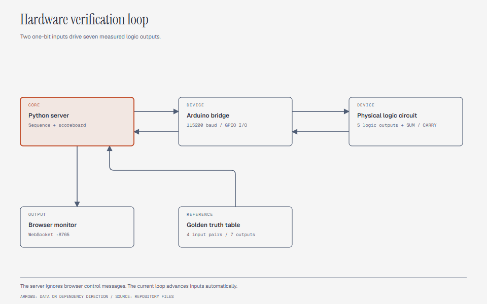

# ALU Hardware Verification

An Arduino and Python test system for a physical logic circuit. It compares seven outputs against a reference table and displays results in a browser.


The repository name uses “2-Bit ALU.” The implemented interface has two one-bit inputs, A and B.
It does not implement a Verilog design or a SystemVerilog UVM environment.

## System design



Python sends input pairs over USB serial. Arduino applies those inputs and reads seven logic outputs.
Python compares the received values with its reference table and broadcasts the result over WebSocket.
The browser displays the current state and comparison results.

## Hardware connections

| Signal | Arduino pin | Direction |
|---|---:|---|
| A | 3 | Output to circuit |
| B | 4 | Output to circuit |
| Clock | 13 | Output to circuit |
| NAND | 8 | Input from circuit |
| NOT A | 9 | Input from circuit |
| OR | 10 | Input from circuit |
| Carry | 5 | Input from circuit |
| Sum | 6 | Input from circuit |
| AND | 11 | Input from circuit |
| XOR | 12 | Input from circuit |

The sketch configures circuit outputs as `INPUT_PULLUP` inputs on Arduino.
Check voltage compatibility and a common ground before wiring.
The old `peripheral.txt` mentions pin 7 as a power connection, but the sketch does not configure that pin.

## Start the monitor

1. Connect the circuit according to the pin table.
2. Open `alu_veriification.ino` in Arduino IDE.
3. Select the board and port.
4. Upload the sketch.
5. Close Serial Monitor so Python can open the port.
6. Set `ARDUINO_PORT` in `alu_server.py` to your device port.

Install the Python packages and start the server:

```sh
python -m pip install pyserial websockets
python alu_server.py
```

Open `index.html` in a browser on the same computer.
The page connects to `ws://127.0.0.1:8765`. The default serial configuration is `COM5` at 115200 baud.

## Reference table

| A | B | NAND | NOT A | OR | Carry | Sum | AND | XOR |
|---:|---:|---:|---:|---:|---:|---:|---:|---:|
| 0 | 0 | 1 | 1 | 0 | 0 | 0 | 0 | 0 |
| 0 | 1 | 1 | 1 | 1 | 0 | 1 | 0 | 1 |
| 1 | 0 | 1 | 0 | 1 | 0 | 1 | 0 | 1 |
| 1 | 1 | 0 | 0 | 1 | 1 | 0 | 1 | 0 |

The serial reply format is `[A,B|NAND_NOTA_OR_CARRY_SUM_AND_XOR]`, with seven adjacent digits after `|`.
For example, `[0,1|1110101]` contains the expected outputs for A=0 and B=1.

Firmware commands are `Mab` for a chosen input pair, `R` for random mode, and `S` to stop random mode.
Commands end with a newline.

## Timing and current behavior

The Python loop advances through four input pairs at a configured interval of 0.5 seconds.
That is two vectors per second and approximately two seconds per full sequence, before additional delays.
The sketch uses a 100-microsecond clock half-period. Serial work adds delay, so this is not a guaranteed 5 kHz clock.

The WebSocket handler ignores messages from the browser. The visible manual and random controls therefore do not control the current Python server.
The server continues its automatic sequence.

`OK` means all seven comparisons match. `MIXED` means some match. `ERROR` means all fail or the input is invalid.
The four reference cases do not establish timing coverage or a completed hardware verification campaign.

## Files and license

`alu_server.py` contains the sequencer and comparison logic. `alu_veriification.ino` contains the Arduino bridge.
`index.html` contains the monitor. The two screenshots and `peripheral.txt` record earlier work.

[MIT](LICENSE) covers original code and documentation by Velan E. See [LICENSING.md](LICENSING.md) for dependency scope.
